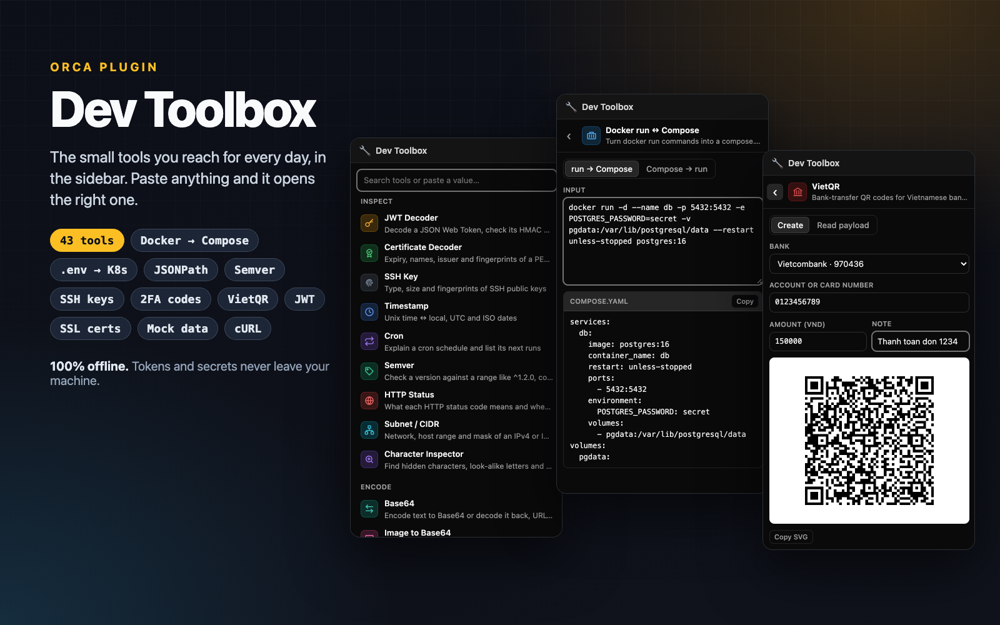

# Dev Toolbox

[](https://github.com/thailoc-dev/orca-dev-toolbox/actions/workflows/ci.yml)
[](CHANGELOG.md)
[](LICENSE)

Decode a JWT, convert a timestamp or format some JSON without leaving [Orca](https://www.onorca.dev)
or asking an agent. 43 small tools in the right sidebar, all offline.



## Install

From the community catalog: open
[Dev Toolbox on onorca.dev](https://www.onorca.dev/plugins/thailoc-dev/orca-dev-toolbox) and click
**Open in Orca**, or search for it in Settings → Plugins.

To get the latest release before the catalog picks it up, install from Git in Settings → Plugins:

```
https://github.com/thailoc-dev/orca-dev-toolbox.git#v0.6.1
```

Requires Orca 1.4.245 or later.

## Usage

Open the panel from the wrench icon in the right sidebar, then paste something into the search
box. Dev Toolbox recognises JWTs, timestamps, JSON, YAML, CSV, SQL, URLs, cron expressions, curl
and docker run commands, `.env` lines, certificates, SSH keys, colours, IP ranges, version ranges
and more, and opens the matching tool with your input.

You can also type to search (`sha256`, `epoch`, `snake`…). <kbd>Enter</kbd> opens the first result,
<kbd>Esc</kbd> goes back to the list. Each tool keeps its input while you switch between them.

## Tools

**Inspect** · JWT (decode, verify and sign HS256/384/512) · Certificate & CSR · SSH Key fingerprints ·
Timestamp · Cron · Semver ranges · HTTP Status · Subnet / CIDR · Character Inspector

**Encode** · Base64 · Image to Base64 · URL · HTML / JSON / Unicode escapes

**Convert** · YAML ↔ JSON · CSV ↔ JSON · `.env` ↔ JSON, Kubernetes Secret or ConfigMap ·
docker run ↔ Compose · JSON to TypeScript, Go, Rust or Python · cURL to fetch, requests or HTTPie ·
HTML to JSX · px ↔ rem · Size & Duration · Color (HEX, RGB, HSL, OKLCH) · Number Base · Chmod

**Format** · JSON · JSON Query (JSONPath) · SQL · XML

**Generate** · Password · UUID v4/v7, ULID, Nano ID · TOTP / 2FA codes · Hash & HMAC · bcrypt &
Basic Auth · Mock data (English or Vietnamese) · QR Code · VietQR bank transfers

**Text** · Transform (remove accents, slugify, lists to SQL `IN`…) · Case Converter · Regex
Tester · Diff · Line Tools · Stats

See the [changelog](CHANGELOG.md) for what changed in each release.

## Privacy

The panel runs in Orca's sandboxed frame, which blocks all network access. Nothing you paste
leaves your machine, and the plugin asks Orca for no permissions.

## Contributing

If Dev Toolbox saves you a trip to a website, a ⭐ on this repository helps other Orca users find it.

Bug reports and tool requests are welcome in [issues](https://github.com/thailoc-dev/orca-dev-toolbox/issues).
See [CONTRIBUTING.md](CONTRIBUTING.md) to build and test locally.

## License

[MIT](LICENSE). Bundled libraries are listed in [THIRD-PARTY-NOTICES.md](THIRD-PARTY-NOTICES.md).
