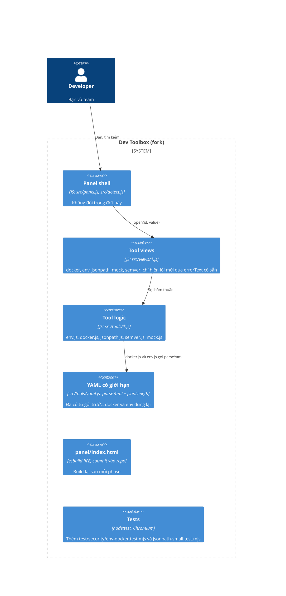

# Cứng hóa các tool lấy từ upstream 0.6.1 - Design

## Containers (C4 L2)

- **Tool logic**: phase 6 sửa `src/tools/env.js` và `src/tools/docker.js`; phase 7 sửa `src/tools/jsonpath.js`,
  `src/tools/semver.js` và `src/tools/mock.js`. Không đụng view trừ khi một thông báo lỗi cần hiện.
- **Tests**: 2 file mới trong `test/security/`; các test của 8 tool do upstream viết phải pass mà không bị sửa.

## Decisions

### D1 - Tên biến: từ chối ở đầu ra thay vì quote hay đổi tên
**Chosen:** `writeEnv` kiểm tên theo mẫu của từng đích (POSIX cho `shell`; mẫu của `parseDotenv` cho `dotenv`, `docker`,
`compose`) và ném lỗi nêu tên sai. `json`, `secret`, `configmap` giữ nguyên (đã an toàn: JSON và `dump`, `k8sKey`).
**Because:** shell không có cách `export` một tên không hợp lệ, nên quote không giúp được; đổi tên âm thầm làm đổi dữ liệu.
**Rejected:** thay ký tự lạ bằng `_` (như `k8sKey`): đổi tên biến mà người dùng không biết. Cắt khóa tại ký tự lạ: mất dữ liệu.
**Trade-off:** JSON có khóa như `spring.datasource.url` vẫn dùng được cho `dotenv`, `docker`, `compose` nhưng không `export`.

### D2 - YAML: dùng lại `parseYaml` của gói trước
**Chosen:** `docker.js` và `env.js` gọi `parseYaml` thay cho `load`. Nếu `documents > 1` thì ném lỗi có chữ "one document".
Thông báo lỗi YAML là thông báo của `parseYaml` (`Not valid YAML (line L, column C): …`), không bọc thêm lần nữa (`composeToRun` bỏ `try/catch` cũ).
`env.js` trước đây để lỗi thô của js-yaml thoát ra; nay dùng thông báo của `parseYaml`. Chỉ đầu vào hợp lệ được đảm bảo giữ đầu ra y hệt.
**Because:** `parseYaml` đã có `jsonLength` (giới hạn 12 triệu ký tự in ra, tính cả alias) và đã được hai reviewer kiểm.
**Rejected:** viết giới hạn riêng cho hai tool: lặp lại logic đã kiểm.

### D3 - Option bị chèn trong `docker run`: từ chối `image` và `container_name` bắt đầu bằng `-`
**Chosen:** ném lỗi. Tên image và container hợp lệ của Docker không bắt đầu bằng `-`. Với `container_name`, Docker thực ra đọc `--name --rm` là
giá trị của `--name`, nên chỉ `image` là chèn cờ thật; vẫn từ chối cả hai (và tên service khi nó làm tên container) vì tên đó không hợp lệ.
Không dùng `--` trước image vì `docker run -- IMAGE` đổi cách đọc cờ.
**Rejected:** bỏ im giá trị: người dùng không biết nó mất.

### D4 - Regex trong JSONPath: bộ khớp riêng, thời gian tuyến tính (bạn chọn phương án A)
**Chosen:** `=~`, `match()` và `search()` không dùng `RegExp` của JavaScript nữa. Một bộ khớp nhỏ trong `src/tools/linear-regex.js` (`src/tools/regex.js` là của tool Regex tester, không đổi) (kiểu Thompson/Pike:
biên dịch mẫu thành chương trình trạng thái, rồi chạy mọi nhánh song song trên chuỗi một lần) trả lời "khớp hay không".
- **Cú pháp hỗ trợ:** ký tự thường và ký tự thoát (`\.`, `\/`, `\n`, `\t`, `\r`, `\uXXXX`, `\xXX`…), `.`, lớp `[...]` (khoảng, phủ định `^`,
  `\d \w \s` bên trong), `\d \D \w \W \s \S`, `\b \B`, `^ $`, nhóm `(...)`, `(?:...)`, nhóm đặt tên `(?<n>...)` (coi như nhóm thường), `|`,
  và mọi lượng từ `* + ? {n} {n,} {n,m}` kể cả dạng lười (với câu hỏi có/không, lười và tham cho cùng kết quả). Cờ `i`, `m`, `s` có nghĩa như
  JavaScript; `g` và `y` giữ nghĩa như mã hiện tại (engine kiểm tra và giữ nguyên).
- **Không hỗ trợ (từ chối):** tham chiếu ngược (`\1`, `\k<n>`), lookahead/lookbehind (`(?=`, `(?!`, `(?<=`, `(?<!`), `\p{...}`, cờ `u`/`v`.
  Thông báo: `This regular expression is not allowed: <tính năng> is not supported`.
- **Giới hạn kích thước:** mẫu tối đa 200 ký tự; chương trình sau khi mở rộng các lặp đếm (`{n,m}`) tối đa 2.000 lệnh; chuỗi dài hơn
  10.000 ký tự coi là không khớp (không ném lỗi). Nhờ vậy mọi lần khớp tối đa khoảng 2.000 × 10.000 bước.
- `match()` là khớp toàn chuỗi, `search()` là khớp một phần: cả hai làm trong bộ khớp (cờ neo), **không** ghép chuỗi `^(?:...)$`.
  Mẫu literal `=~` được biên dịch khi phân tích đường dẫn (lỗi cú pháp và tính năng không hỗ trợ báo ngay); mẫu của `match()`/`search()`
  (có thể đến từ dữ liệu) biên dịch khi chạy.
**Because:** đếm lượng từ không giới hạn được thời gian: `\w+\w+$` trên 2.000 ký tự mất 4,5 s, `\w+\w+\w+$` trên 800 ký tự 52-227 s,
`^(a|a?){16}b` 4 s, và đã có cách vượt qua bằng mẫu không cân ngoặc. JavaScript không hủy được regex đang chạy, panel không có worker.
JSONPath chỉ cần câu trả lời có/không, nên một bộ khớp không quay lui là nhỏ và **đảm bảo** không treo.
**Rejected:** quy tắc đếm lượng từ của bản D4 trước (B: vẫn treo, từ chối mẫu thật); bỏ regex (C: mất tính năng); Web Worker (đổi API thành bất đồng bộ).

### D5 - `push(...spread)`: thay bằng vòng `for`
**Chosen:** như đã làm ở `checkSize` của gói trước.

### D6 - Mock và semver: sửa nhỏ nhất
**Chosen:** `mock`: tên bảng phải là định danh SQL (một hoặc hai đoạn). `semver`: cắt phần đầu vào trong thông báo lỗi.

## Agent's calls

- **Bạn chọn A (14:3x):** bộ khớp regex tuyến tính cho JSONPath thay cho quy tắc đếm lượng từ (D4 mới).

- Footer hai liên kết trỏ về fork `loind/orca-dev-toolbox` thay vì upstream (bạn chưa nói). Test footer của upstream đã đổi theo.
- Quy trình giống gói trước: engine, hai reviewer độc lập, gate do tôi chạy, tôi commit trên nhánh `merge-upstream-0.6.1`.
  Chỉ khi cả hai phase xong và kiểm tra cuối đạt thì tôi hợp nhất vào `main` và push.
- Đầu ra `.env` có `$(...)` khi `source` file: chỉ ghi nhận (xem Out of scope).
- Phép thử khai thác của tôi chạy lại ở cuối làm kiểm tra cuối (verifier), thay cho một phiên agent riêng.
- Documenter chạy ở cuối: README, CHANGELOG, mô tả manifest (44 tool), và hai gói thiết kế.

- Quyết định sau builder check (bạn đổi được): (1) tên biến sai làm cả tab đầu ra thất bại kèm thông báo nêu tên đó, thay vì bỏ qua âm thầm từng biến
  (với `shell`, shell không `export` được tên có dấu chấm hay gạch ngang, nên báo lỗi rõ tốt hơn mất dữ liệu); khóa ở đầu vào `docker -e` và JSON vẫn
  được đọc, kiểm khi ghi. (2) Regex JSONPath: mục tiêu là chặn các dạng backtracking theo hàm mũ đã biết cộng giới hạn kích thước; không hứa
  "không regex nào treo" (xem D4). (3) Chuỗi quá dài so với regex coi là không khớp, không ném lỗi. (4) `image` không phải chuỗi được đổi sang chuỗi.
  (5) Chỉ từ nguyên vẹn bắt đầu bằng `=` được quote. (6) Độ sâu JSON cũng nằm trong REQ-032 (`descendants` thành vòng lặp). (7) Mọi chỗ semver chép đầu vào
  vào thông báo đều bị cắt; dữ liệu trả về của `sortVersions` giữ nguyên. (8) Engine không commit, không push, không chạy `npm ci`.

## Design problems

1. **`panel/index.html` dùng chung**: hai phase chạy tuần tự, như trước.
2. **Regex bảo thủ có thể từ chối mẫu hợp lệ**: người dùng JSONPath thường viết `^...$` đơn giản, nên ít ảnh hưởng. Đã ghi rõ trong thông báo lỗi.
3. **Nhánh dài hạn**: lần merge upstream sau sẽ xung đột cùng chỗ và có thể xung đột với các sửa ở `docker.js`, `env.js`,
   `jsonpath.js`. Công thức giải quyết xung đột nằm trong memory.
4. **Test thời gian**: gate chung chứa vài test thời gian flaky đã biết của Phase 1 và 2 (không sửa trong đợt này);
   gate phase mới không dựa vào thời gian chặt (biên rộng).
