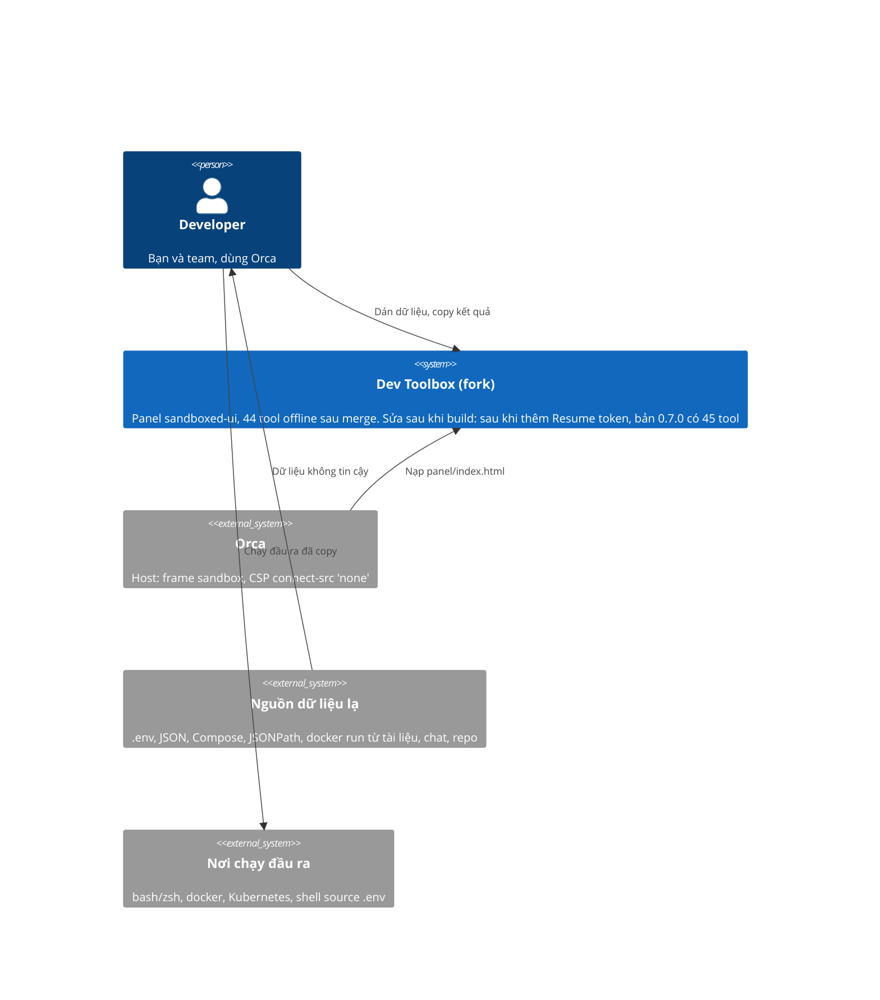

# Cứng hóa các tool lấy từ upstream 0.6.1 - SRS

## System context (C4 L1)

Phạm vi và ranh giới như gói thiết kế trước (`docs/design/security-fixes-and-objectid/srs.md`): chỉ hai thứ đi qua
ranh giới là text được dán vào và text được copy ra; panel không dùng network.

## Requirements

| Id | Type | Pri | Requirement | Rationale | Verify |
|---|---|---|---|---|---|
| REQ-028 | FR | must | `writeEnv(pairs, 'shell')` ném lỗi khi một tên biến không khớp `^[A-Za-z_][A-Za-z0-9_]*$`, với thông báo nêu tên đó. Mọi tên hợp lệ ra đúng `export NAME='...'` như hôm nay, trừ giá trị bắt đầu bằng `=` hoặc chứa `:=`: các giá trị đó được đặt trong nháy đơn. | Khóa như `a;touch /tmp/x` từ JSON hoặc `docker -e` ra `export a;touch /tmp/x=1`: chạy trong bash và zsh sẽ thực thi `touch`. Giá trị `=ls` ra `export A==ls`, zsh đổi thành `/bin/ls`. | Test |
| REQ-029 | FR | must | `writeEnv(pairs, target)` với `target` là `dotenv`, `docker` hoặc `compose` ném lỗi khi tên không khớp `^[A-Za-z_][A-Za-z0-9_.-]*$` (đúng mẫu mà `parseDotenv` dùng). Đầu ra cho tên hợp lệ không đổi. Giá trị có `\r` đi vòng `writeEnv(…, 'dotenv')` rồi `parseDotenv` ra đúng giá trị ban đầu. | Khóa chứa xuống dòng chèn thêm dòng vào `.env`; khóa có `=` hoặc khoảng trắng đổi nghĩa của `-e`; `\r` thô làm đổi giá trị khi đọc lại. | Test |
| REQ-030 | FR | must | `readEnv()` (đầu vào Secret hoặc ConfigMap) và `composeToRun()` đọc YAML qua `parseYaml()` của `src/tools/yaml.js`, nên một alias bomb bị từ chối với lỗi nhắc "aliases" trong 2.000 ms (Sửa sau khi build: giới hạn thật là của `parseYaml`: tài liệu in ra JSON quá 12.000.000 ký tự, alias tính mỗi lần được dùng, thì bị từ chối; lỗi có dạng `Not valid YAML: The document would print as more than 12000000 characters of JSON (aliases count each time they are used).`. Một tài liệu có alias nhưng nhỏ hơn mức đó vẫn được đọc). YAML bình thường cho kết quả y hệt hôm nay. Thông báo lỗi YAML là thông báo của `parseYaml` (không bọc thêm lần nữa); một Compose hay Secret có nhiều document ném lỗi nhắc "one document". | Hai chỗ gọi thẳng `load` của js-yaml, bỏ qua giới hạn của REQ-004: Compose 437 byte ra 40 triệu ký tự. | Test |
| REQ-031 | FR | must | `composeToRun()` ném lỗi khi giá trị sẽ đứng sau `--name` (từ `container_name`, hoặc tên service khi không có `container_name`) hoặc tên `image` (đã đổi sang chuỗi) bắt đầu bằng `-`. Mọi từ nguyên vẹn bắt đầu bằng `=` trong lệnh sinh ra được đặt trong nháy đơn; từ có `=` ở giữa (`K==zsh`) giữ nguyên. | `image: "--privileged"` ra `docker run -d --name a --privileged`; zsh mở rộng từ `=lệnh` thành đường dẫn. | Test |
| REQ-036 | NFR | must | `parseDotenv()` và `runToCompose()` chạy trong thời gian tuyến tính theo kích thước đầu vào: `A=x` + 80.000 dấu cách + `y` xong dưới 1.000 ms; `A="` + 100.000 dòng `b` (không đóng nháy) ném lỗi "never closes" như hôm nay dưới 1.000 ms; 20.000 dòng `docker run x` qua `runToCompose` xong dưới 1.000 ms. Kết quả cho đầu vào bình thường giữ y hệt. | Mã upstream chạy bình phương: 80.000 dấu cách mất 10,4 s, 40.000 dòng nháy không đóng mất 4,5 s, 20.000 dòng `docker run x` mất 16,6 s. Cùng lớp với REQ-001 và REQ-002. | Test |
| REQ-037 | FR | should | `composeToRun()` không ném `TypeError` với một service rỗng (`services:\n  a:\n`): cho lệnh như một service không có trường nào (`docker run -d --name a '<a-image>'`) kèm ghi chú `a: uses build:`. Một tên service hay biến `__proto__` không làm lỗi hay mất dữ liệu (Sửa sau khi build: đã làm, bằng `Object.create(null)` cho `services` và `keyValues` trong `src/tools/docker.js`; test `REQ-037: a service or a variable called __proto__ is kept`). | `Cannot read properties of null (reading 'image')` hiện thẳng trong giao diện. | Test |
| REQ-032 | FR | must | `queryJson(data, path)` không bao giờ ném `RangeError` vì số kết quả hay vì độ sâu của dữ liệu: `$..id` trên 200.000 phần tử trả đúng 200.000 kết quả; `$.a[0:1000000000]` trên mảng 1.000.000 phần tử trả 1.000.000 kết quả; bộ lọc `[?(@.id==@.id)]` trên 200.000 phần tử trả 200.000 kết quả; `$..x` trên JSON lồng 3.000 tầng trả đúng kết quả. | Hai chỗ dùng `push(...spread)` (jsonpath.js dòng 290 và 327) vượt giới hạn số đối số từ khoảng 125.000 kết quả; `descendants` đệ quy theo độ sâu. Sửa sau khi build: hai chỗ `push(...spread)` đã thành vòng `for`; `descendants` dùng ngăn xếp tường minh, giữ thứ tự tài liệu (`src/tools/jsonpath.js`). Test còn chạy `$..x` trên JSON lồng 30.000 tầng. | Test |
| REQ-033 | FR | must | Bộ lọc regex của JSONPath (`=~`, `match()`, `search()`) dùng bộ khớp tuyến tính `src/tools/linear-regex.js` của `design.md` D4 (Thompson/Pike, không quay lui). Mỗi truy vấn `queryJson` có một ngân sách công việc chung cho mọi lần khớp regex, đếm bằng số trạng thái: `BUDGET` 20.000.000, cộng 10 trạng thái (`FREE_PER_CHAR`) cho mỗi ký tự được tìm, cộng 64 trạng thái (`COMPILE_COST`) cho mỗi lệnh của mỗi mẫu biên dịch trong lúc truy vấn. Vượt ngân sách thì ném lỗi `This query does too much regular expression work …`. Sửa sau khi build: ngân sách tuyến tính theo dữ liệu, không còn là "~2 s bất kể dữ liệu": phần dư tối đa 20.000.000 trạng thái mất khoảng 0,1-0,9 s (đo trên máy build), nhưng công việc dưới 10 trạng thái mỗi ký tự là miễn phí, nên một truy vấn thường trên log 10 MB không chạm ngân sách và có thể chạy vài giây. Mỗi lần khớp cũng có giới hạn riêng: mẫu tối đa 200 ký tự; chương trình sau khi mở rộng `{n,m}` tối đa 2.000 lệnh; chuỗi dài hơn 10.000 ký tự coi là không khớp (không ném lỗi). Kết quả có/không giống `RegExp` của JavaScript (không cờ `u`) cho mọi mẫu trong cú pháp hỗ trợ, kể cả cờ `i` với mọi ký tự BMP. Tính năng không hỗ trợ (tham chiếu ngược, lookaround, `\p{…}`, cờ nhúng `(?i:…)`, cờ `u`/`v`), mẫu sai cú pháp và mẫu quá giới hạn ném lỗi bắt đầu bằng `This regular expression is not allowed`. Giới hạn đã chấp nhận: với cờ `g`/`y`, `lastIndex` có thể khác JavaScript khi một vòng lặp có thể khớp rỗng; `match()`/`search()` không còn cờ `u` (ký tự astral là hai đơn vị UTF-16). Mẫu literal `=~` biên dịch lúc phân tích đường dẫn, ngoài ngân sách. Bộ tách token của đường dẫn chạy tuyến tính theo độ dài đường dẫn. | Mẫu như `(a+)+$`, `^(a\|a?){16}b`, `\w+\w+\w+$` hoặc `a+)+(?:b` qua `match()` treo panel từ giây tới giờ; đường dẫn 60 ký tự có 22 cặp `\\` treo bộ tách token 30 s; một mẫu gần trần trên 200.000 phần tử mất hàng phút. | Test |
| REQ-034 | FR | should | Mọi thông báo lỗi của semver có chép đầu vào (`parseVersion`, `compareVersions`, `partial` dùng bởi `parseRange`, `satisfies`, `describeRange`, `increment`, và thông báo `Not versions:` của view sắp xếp) chứa tối đa 120 đơn vị UTF-16 đầu tiên của mỗi đầu vào (sau `trim()`, không cắt đôi một cặp surrogate), kèm `…` khi bị cắt. Đầu vào ngắn giữ thông báo y hệt hôm nay. `parseVersion` chạy tuyến tính kể cả với một chuỗi dài toàn khoảng trắng. Thông báo lỗi dài không ngắt dòng không làm panel cuộn ngang. Sửa sau khi build: `VERSION` khớp trên chuỗi đã `trim()` (không còn `\s*` đầu mẫu); `shown()` được xuất từ `src/tools/semver.js` và dùng cả cho tên `kind` lạ của `increment` (`Unknown increment …`) và trong view (`src/views/semver.js`); chống cuộn ngang bằng `overflow-wrap: anywhere` cho `.error` trong `src/panel.css`. | Đầu vào 1 MB làm thông báo lỗi dài 1 MB; `^\s*[v=]?\s*` mất 2,7 s với 40.000 dấu cách trong ô Range; lỗi dài không ngắt dòng gây cuộn ngang ở 300 px. | Test |
| REQ-035 | FR | should | `formatRows(rows, 'sql', { table })`: `table` rỗng, `null` hoặc `undefined` dùng `users` như hôm nay ở view; một `table` khác không khớp `^[A-Za-z_][A-Za-z0-9_]*(\.[A-Za-z_][A-Za-z0-9_]*)?$` ném lỗi (Sửa sau khi build: kiểu không phải chuỗi như `0`, `false`, `{}` hay mảng cũng bị từ chối, thông báo `The table name must be a SQL identifier such as users or public.users.`); tên hợp lệ cho đầu ra y hệt hôm nay. Các định dạng khác không đọc `table`. | Tên bảng `users; DROP TABLE x; --` được ghi nguyên vào câu SQL. | Test |

## Constraints & assumptions

- Quy tắc của repo (CONTRIBUTING.md): không network, analytics hay runtime dependency mới; `panel/index.html` là một file
  được commit và phải khớp source (CI chạy `npm run check`).
- Môi trường như gói trước: Node ≥ 20.11, Chromium headless trong cache của playwright, `~/.npm` có file thuộc root nên
  lệnh npm cần `--cache /tmp/npm-cache-odt`.
- Kết quả kiểm nhanh ở trên là của tôi (orchestrator), chạy bằng thực thi trên cây merge ngày 2026-11-04. Sửa sau khi build:
  mỗi phase đã có hai reviewer độc lập (QC và code reviewer, phase 2 qua 4 vòng); các điều đã kiểm được ghi trong `.prime/orchestrator/board.json`.
- Tool sshkey, totp, vietqr, semver (hiệu năng), mock (giới hạn 1000 dòng ở view) đã được thử và không có lỗi; đây là kiểm
  nhanh, không phải review đầy đủ.
- Gate chung xanh trên nhánh merge: `npm test` 165/165, hai lần liên tiếp. Sửa sau khi build: sau hai phase, `npm test` xanh 218/218 (board, cuối phase 2); trên nhánh sau khi hợp nhất tool resume token xanh 248/248 (chạy lại khi viết tài liệu này; gate phase `test/security/env-docker.test.mjs` 24/24 và `test/security/jsonpath-small.test.mjs` 30/30).
