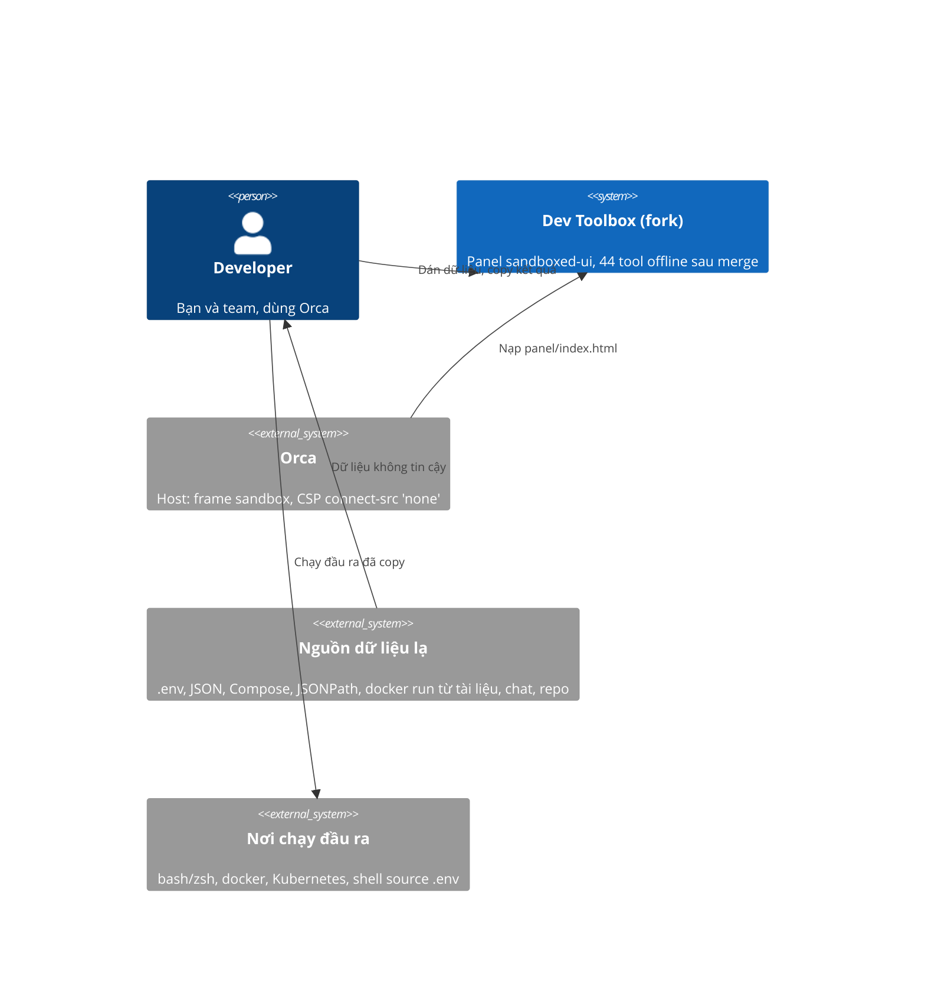

# Cứng hóa các tool lấy từ upstream 0.6.1 - SRS

## System context (C4 L1)

Phạm vi và ranh giới như gói thiết kế trước (`docs/design/security-fixes-and-objectid/srs.md`): chỉ hai thứ đi qua
ranh giới là text được dán vào và text được copy ra; panel không dùng network.

## Requirements

| Id | Type | Pri | Requirement | Rationale | Verify |
|---|---|---|---|---|---|
| REQ-028 | FR | must | `writeEnv(pairs, 'shell')` ném lỗi khi một tên biến không khớp `^[A-Za-z_][A-Za-z0-9_]*$`, với thông báo nêu tên đó. Mọi tên hợp lệ ra đúng `export NAME='...'` như hôm nay. | Khóa như `a;touch /tmp/x` từ JSON hoặc `docker -e` ra `export a;touch /tmp/x=1`: chạy trong bash và zsh sẽ thực thi `touch`. | Test |
| REQ-029 | FR | must | `writeEnv(pairs, target)` với `target` là `dotenv`, `docker` hoặc `compose` ném lỗi khi tên không khớp `^[A-Za-z_][A-Za-z0-9_.-]*$` (đúng mẫu mà `parseDotenv` dùng). Đầu ra cho tên hợp lệ không đổi. | Khóa chứa xuống dòng chèn thêm dòng vào `.env`; khóa có `=` hoặc khoảng trắng đổi nghĩa của `-e`. | Test |
| REQ-030 | FR | must | `readEnv()` (đầu vào Secret hoặc ConfigMap) và `composeToRun()` đọc YAML qua `parseYaml()` của `src/tools/yaml.js`, nên một alias bomb bị từ chối với lỗi nhắc "aliases" trong 500 ms, và YAML bình thường cho kết quả y hệt hôm nay. | Hai chỗ gọi thẳng `load` của js-yaml, bỏ qua giới hạn của REQ-004: Compose 437 byte ra 40 triệu ký tự. | Test |
| REQ-031 | FR | must | `composeToRun()` ném lỗi khi `image` hoặc `container_name` bắt đầu bằng `-`; mọi từ bắt đầu bằng `=` trong lệnh sinh ra được đặt trong nháy đơn. | `image: "--privileged"` ra `docker run -d --name a --privileged`; zsh mở rộng `=lệnh` thành đường dẫn. | Test |
| REQ-032 | FR | must | `queryJson(data, path)` không bao giờ ném `RangeError` vì số kết quả: `$..id` trên 200.000 phần tử trả đúng 200.000 kết quả; `$.a[0:1000000000]` trên mảng 1.000.000 phần tử trả 1.000.000 kết quả; bộ lọc `[?(@.id==@.id)]` trên 200.000 phần tử trả 200.000 kết quả. | Hai chỗ dùng `push(...spread)` (jsonpath.js dòng 290 và 327) vượt giới hạn số đối số từ khoảng 125.000 kết quả. | Test |
| REQ-033 | FR | must | Bộ lọc regex của JSONPath (`=~`, `match()`, `search()`) từ chối với thông báo lỗi các mẫu có nhóm bị lượng từ bao (`*`, `+`, `{n,}`, `{n,m}`) mà bên trong nhóm có lượng từ khác hoặc phép chọn `\|`, mẫu dài hơn 200 ký tự, và chỉ so với chuỗi dài tối đa 10.000 ký tự. Các mẫu `(a+)+$`, `(a\|aa)+$`, `(a*)*b`, `(.*a){20}` bị từ chối trong 50 ms; `^[A-Z]\w+$`, `^\d{3}-\d{4}$`, `^(png\|jpg)$` vẫn chạy đúng. | Một chuỗi 41 ký tự với `(a+)+$` mất 204 giây. | Test |
| REQ-034 | FR | should | Thông báo lỗi của `parseVersion` và `compareVersions` (semver) chứa tối đa 120 ký tự của đầu vào, kèm dấu `…` khi bị cắt. | Đầu vào 1 MB làm thông báo lỗi dài 1 MB. | Test |
| REQ-035 | FR | should | `formatRows(rows, 'sql', { table })` ném lỗi khi `table` không khớp `^[A-Za-z_][A-Za-z0-9_]*(\.[A-Za-z_][A-Za-z0-9_]*)?$`; tên hợp lệ cho đầu ra y hệt hôm nay. | Tên bảng `users; DROP TABLE x; --` được ghi nguyên vào câu SQL. | Test |

## Constraints & assumptions

- Quy tắc của repo (CONTRIBUTING.md): không network, analytics hay runtime dependency mới; `panel/index.html` là một file
  được commit và phải khớp source (CI chạy `npm run check`).
- Môi trường như gói trước: Node ≥ 20.11, Chromium headless trong cache của playwright, `~/.npm` có file thuộc root nên
  lệnh npm cần `--cache /tmp/npm-cache-odt`.
- Kết quả kiểm nhanh ở trên là của tôi (orchestrator), chạy bằng thực thi trên cây merge ngày 2026-11-04. Chưa có reviewer
  độc lập nào kiểm lại; hai reviewer mỗi phase sẽ làm việc đó.
- Tool sshkey, totp, vietqr, semver (hiệu năng), mock (giới hạn 1000 dòng ở view) đã được thử và không có lỗi; đây là kiểm
  nhanh, không phải review đầy đủ.
- Gate chung xanh trên nhánh merge: `npm test` 165/165, hai lần liên tiếp.
