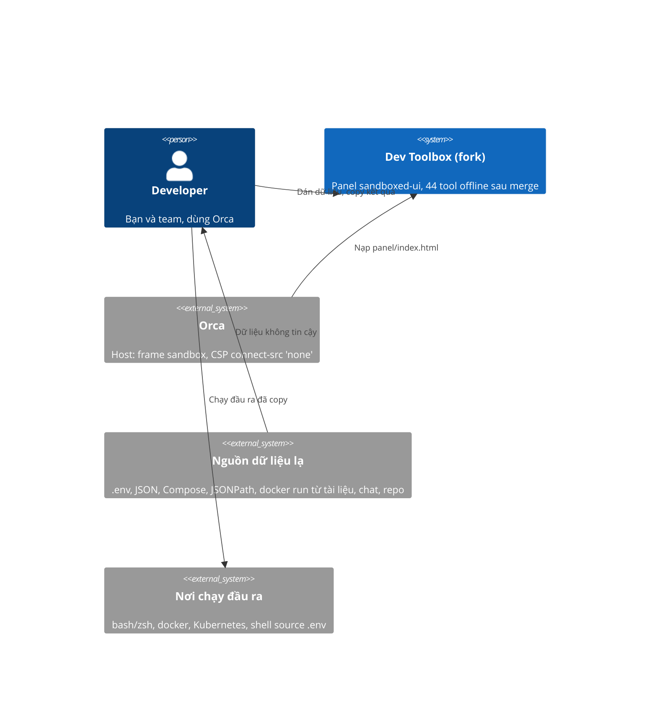

# Cứng hóa các tool lấy từ upstream 0.6.1 - SRS

## System context (C4 L1)

Phạm vi và ranh giới như gói thiết kế trước (`docs/design/security-fixes-and-objectid/srs.md`): chỉ hai thứ đi qua
ranh giới là text được dán vào và text được copy ra; panel không dùng network.

## Requirements

| Id | Type | Pri | Requirement | Rationale | Verify |
|---|---|---|---|---|---|
| REQ-028 | FR | must | `writeEnv(pairs, 'shell')` ném lỗi khi một tên biến không khớp `^[A-Za-z_][A-Za-z0-9_]*$`, với thông báo nêu tên đó. Mọi tên hợp lệ ra đúng `export NAME='...'` như hôm nay, trừ giá trị bắt đầu bằng `=` hoặc chứa `:=`: các giá trị đó được đặt trong nháy đơn. | Khóa như `a;touch /tmp/x` từ JSON hoặc `docker -e` ra `export a;touch /tmp/x=1`: chạy trong bash và zsh sẽ thực thi `touch`. Giá trị `=ls` ra `export A==ls`, zsh đổi thành `/bin/ls`. | Test |
| REQ-029 | FR | must | `writeEnv(pairs, target)` với `target` là `dotenv`, `docker` hoặc `compose` ném lỗi khi tên không khớp `^[A-Za-z_][A-Za-z0-9_.-]*$` (đúng mẫu mà `parseDotenv` dùng). Đầu ra cho tên hợp lệ không đổi. Giá trị có `\r` đi vòng `writeEnv(…, 'dotenv')` rồi `parseDotenv` ra đúng giá trị ban đầu. | Khóa chứa xuống dòng chèn thêm dòng vào `.env`; khóa có `=` hoặc khoảng trắng đổi nghĩa của `-e`; `\r` thô làm đổi giá trị khi đọc lại. | Test |
| REQ-030 | FR | must | `readEnv()` (đầu vào Secret hoặc ConfigMap) và `composeToRun()` đọc YAML qua `parseYaml()` của `src/tools/yaml.js`, nên một alias bomb bị từ chối với lỗi nhắc "aliases" trong 2.000 ms. YAML bình thường cho kết quả y hệt hôm nay. Thông báo lỗi YAML là thông báo của `parseYaml` (không bọc thêm lần nữa); một Compose hay Secret có nhiều document ném lỗi nhắc "one document". | Hai chỗ gọi thẳng `load` của js-yaml, bỏ qua giới hạn của REQ-004: Compose 437 byte ra 40 triệu ký tự. | Test |
| REQ-031 | FR | must | `composeToRun()` ném lỗi khi giá trị sẽ đứng sau `--name` (từ `container_name`, hoặc tên service khi không có `container_name`) hoặc tên `image` (đã đổi sang chuỗi) bắt đầu bằng `-`. Mọi từ nguyên vẹn bắt đầu bằng `=` trong lệnh sinh ra được đặt trong nháy đơn; từ có `=` ở giữa (`K==zsh`) giữ nguyên. | `image: "--privileged"` ra `docker run -d --name a --privileged`; zsh mở rộng từ `=lệnh` thành đường dẫn. | Test |
| REQ-036 | NFR | must | `parseDotenv()` và `runToCompose()` chạy trong thời gian tuyến tính theo kích thước đầu vào: `A=x` + 80.000 dấu cách + `y` xong dưới 1.000 ms; `A="` + 100.000 dòng `b` (không đóng nháy) ném lỗi "never closes" như hôm nay dưới 1.000 ms; 20.000 dòng `docker run x` qua `runToCompose` xong dưới 1.000 ms. Kết quả cho đầu vào bình thường giữ y hệt. | Mã upstream chạy bình phương: 80.000 dấu cách mất 10,4 s, 40.000 dòng nháy không đóng mất 4,5 s, 20.000 dòng `docker run x` mất 16,6 s. Cùng lớp với REQ-001 và REQ-002. | Test |
| REQ-037 | FR | should | `composeToRun()` không ném `TypeError` với một service rỗng (`services:\n  a:\n`): cho lệnh như một service không có trường nào (`docker run -d --name a '<a-image>'`) kèm ghi chú `a: uses build:`. Một tên service hay biến `__proto__` không làm lỗi hay mất dữ liệu nếu cách sửa gọn; nếu không thì bỏ qua phần này và báo lại. | `Cannot read properties of null (reading 'image')` hiện thẳng trong giao diện. | Test |
| REQ-032 | FR | must | `queryJson(data, path)` không bao giờ ném `RangeError` vì số kết quả hay vì độ sâu của dữ liệu: `$..id` trên 200.000 phần tử trả đúng 200.000 kết quả; `$.a[0:1000000000]` trên mảng 1.000.000 phần tử trả 1.000.000 kết quả; bộ lọc `[?(@.id==@.id)]` trên 200.000 phần tử trả 200.000 kết quả; `$..x` trên JSON lồng 3.000 tầng trả đúng kết quả. | Hai chỗ dùng `push(...spread)` (jsonpath.js dòng 290 và 327) vượt giới hạn số đối số từ khoảng 125.000 kết quả; `descendants` đệ quy theo độ sâu. | Test |
| REQ-033 | FR | must | Bộ lọc regex của JSONPath (`=~`, `match()`, `search()`) từ chối với thông báo lỗi `This regular expression is not allowed: <lý do>` mọi mẫu vi phạm quy tắc ở `design.md` D4, và chỉ so với chuỗi dài tối đa 2.000 ký tự (chuỗi dài hơn coi là không khớp, không ném lỗi). Quy tắc là hợp đồng; các mẫu nêu trong phase chỉ là ví dụ kiểm thử. | Một chuỗi 41 ký tự với `(a+)+$` mất 204 giây. Đây là kiểm tra bảo thủ cho các dạng backtracking theo hàm mũ; xem giới hạn đã chấp nhận ở D4. | Test |
| REQ-034 | FR | should | Mọi thông báo lỗi của semver có chép đầu vào (`parseVersion`, `compareVersions`, `partial` dùng bởi `parseRange`, `satisfies`, `describeRange`, `increment`) chứa tối đa 120 đơn vị UTF-16 đầu tiên của đầu vào (sau `trim()`, không cắt đôi một cặp surrogate), kèm `…` khi bị cắt. Đầu vào ngắn giữ thông báo y hệt hôm nay. | Đầu vào 1 MB làm thông báo lỗi dài 1 MB. | Test |
| REQ-035 | FR | should | `formatRows(rows, 'sql', { table })`: `table` rỗng, `null` hoặc `undefined` dùng `users` như hôm nay ở view; một `table` khác không khớp `^[A-Za-z_][A-Za-z0-9_]*(\.[A-Za-z_][A-Za-z0-9_]*)?$` ném lỗi; tên hợp lệ cho đầu ra y hệt hôm nay. | Tên bảng `users; DROP TABLE x; --` được ghi nguyên vào câu SQL. | Test |

## Constraints & assumptions

- Quy tắc của repo (CONTRIBUTING.md): không network, analytics hay runtime dependency mới; `panel/index.html` là một file
  được commit và phải khớp source (CI chạy `npm run check`).
- Môi trường như gói trước: Node ≥ 20.11, Chromium headless trong cache của playwright, `~/.npm` có file thuộc root nên
  lệnh npm cần `--cache /tmp/npm-cache-odt`.
- Kết quả kiểm nhanh ở trên là của tôi (orchestrator), chạy bằng thực thi trên cây merge ngày 2026-11-04. Chưa có reviewer
  độc lập nào kiểm lại; hai reviewer mỗi phase sẽ làm việc đó.
- Tool sshkey, totp, vietqr, semver (hiệu năng), mock (giới hạn 1000 dòng ở view) đã được thử và không có lỗi; đây là kiểm
  nhanh, không phải review đầy đủ.
- Gate chung xanh trên nhánh merge: `npm test` 165/165, hai lần liên tiếp.
